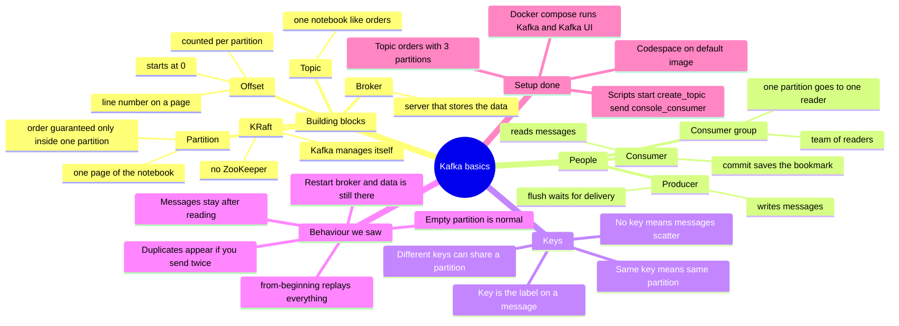

# Day 1 completion recap: Kafka basics + working setup

Quick-revision sheet. Read the mind map first, then the cheat sheet. Takes about 5 minutes.

## 1. Mind map



## 2. Plain-text outline (works in MindMup)
In MindMup: open a new map, then paste this outline (Edit, then Paste, or use Import text).

```
Kafka basics
	Building blocks
		Topic - one notebook (orders)
		Partition - one page, order only inside one partition
		Offset - line number on a page, starts at 0, per partition
		Broker - server storing data
		KRaft - Kafka manages itself, no ZooKeeper
	People
		Producer - writes messages
		Consumer - reads messages
		Consumer group - team of readers, one partition per reader
	Keys
		Key = label on a message
		Same key -> same partition
		Different keys can share a partition
		No key -> messages scatter
	Behaviour we saw
		Messages stay after being read
		Restart broker, data survives
		from-beginning replays all
		Duplicates if sent twice
		Empty partition is normal
	Setup done
		Codespace default image
		docker compose: Kafka + Kafka UI
		Topic orders, 3 partitions
		Scripts: start, create_topic, send, console_consumer
```

## 3. Cheat sheet

| Term | One-line meaning |
|---|---|
| Topic | A named stream of messages (the notebook) |
| Partition | A slice of a topic; the unit of ordering and parallelism |
| Offset | Position of a message inside one partition |
| Key | Decides the partition; same key, same partition |
| Consumer group | Readers sharing the partitions of a topic |
| Commit | Saving "I have processed up to here" |
| Lag | Latest offset minus committed offset |

Golden rules
1. Order is guaranteed only inside one partition.
2. Key choice is a design decision.
3. Reading does not delete messages.
4. Partition count caps parallelism.

## 4. What our run showed
- C2 messages all went to partition 2, with offsets 0, 1, 2, and so on.
- C1 and C3 shared partition 0. Different keys can share a partition.
- C1 `hello` (offset 12) came before `second-order` (offset 13): per-key order held.
- Partition 1 stayed empty because none of our keys landed on it.
- Repeated `world` and `RK` lines were just messages we sent more than once.

## 5. Commands used

```bash
scripts/start.sh                            # start Kafka + Kafka UI
scripts/create_topic.sh orders 3            # create topic with 3 partitions
scripts/send.sh orders C1:hello C2:world    # send key:value messages
scripts/console_consumer.sh                 # read with partition and offset
docker compose restart kafka                # restart test
git add -A && git commit -m "msg" && git push
```

## 6. Lessons learned (setup problems we solved)
- GitHub uploads skip dot-folders, so `.devcontainer` went missing.
- A custom devcontainer failed because of an outdated Yarn package source in the base image, and Codespaces dropped into recovery mode. The default codespace image worked fine, so we used it.
- Interactive typing into `docker exec -it` garbled input in the browser terminal. `scripts/send.sh` (pipes messages in) is more reliable.
- Console producer needs every line as `key:value`. An empty line crashes it.

## 7. Self-quiz (answer aloud)
1. What does offset 5 on partition 2 mean?
2. Why did every C2 message land on the same partition?
3. Does reading a message delete it?
4. Where is order guaranteed, and where not?
5. Why can two different keys end up on one partition?

Answers: 1) the 6th message on partition 2. 2) The key decides the partition. 3) No. 4) Guaranteed inside one partition, not across partitions. 5) There are only 3 partitions, so keys share them.

## 8. Next
- Day 3: Python producer (`labs/lab01_first_events/producer.py`)
- Day 4: Python consumer, commits and replay
- Day 5: Several consumers, rebalancing
